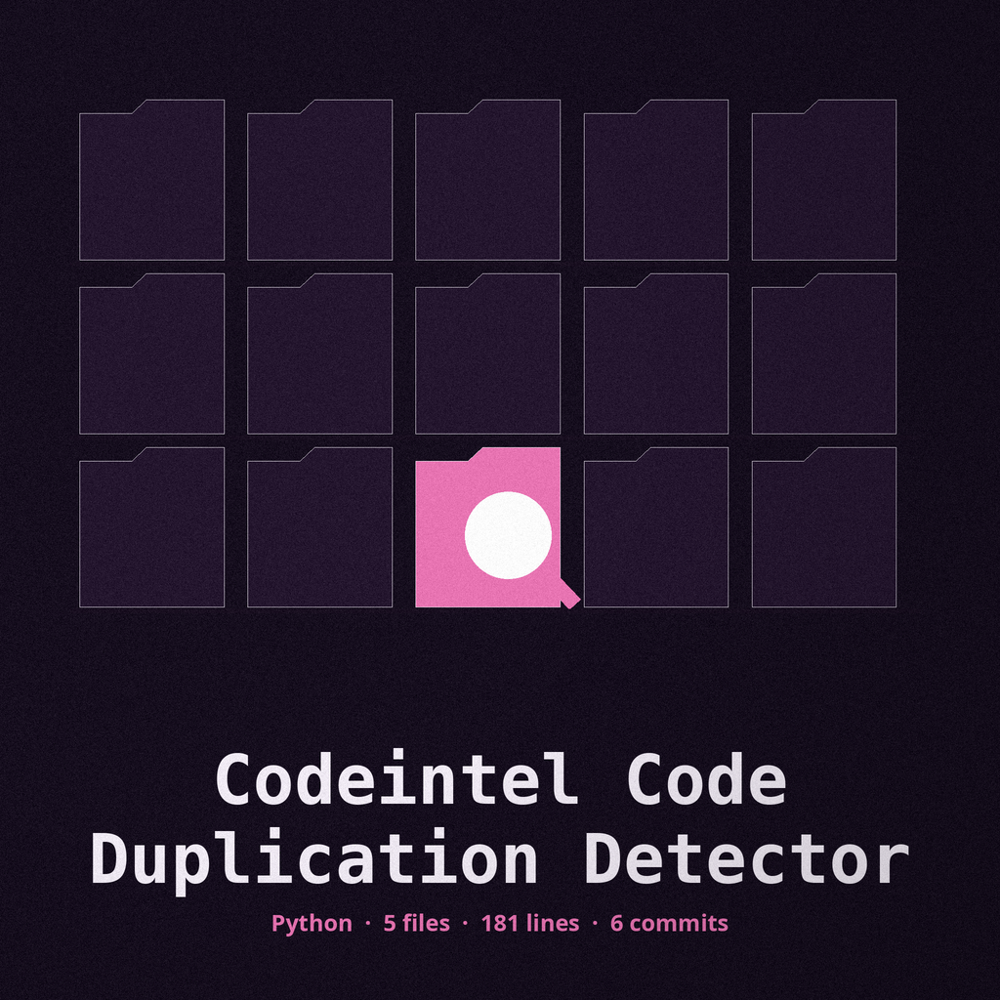
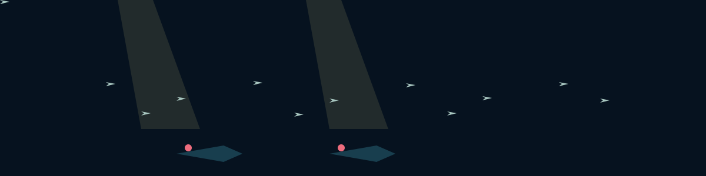

# codeintel-Code-Duplication-Detector

Depth marker treatment: every heading is a marker tied on a sounding line, in Barriecito in dark blue on pale turquoise, ruled below.

Identifies and reports instances of duplicated code blocks within a codebase to improve maintainability and reduce potential bugs. If any Python file under the target cannot be read, the report still covers the files that were read, names the unreadable files in the log and in the report, does not print the clean no duplicates line for that run, and the run exits 1. - Focused on Tools for static code analysis, vulnerability scanning, and code quality assurance

> **Dive log note, on the troubled run.** The opening account above keeps its four consequences together as printed: the report covers the files that were read, unreadable files are named, the clean line is not printed, and the run exits 1.

## Install
`git clone https://github.com/ShadowStrikeHQ/codeintel-code-duplication-detector`

> **Dive log note, flagged in place.** The install line above reads git clone https://github.com/ShadowStrikeHQ/codeintel-code-duplication-detector, naming ShadowStrikeHQ in place of ShadowGuard-AI. It is preserved exactly as printed and flagged here, never silently fixed.

## Usage
`./codeintel-code-duplication-detector [params]`

> **Dive log note, on the missing target.** The usage line above names no target path, and none of the four parameters below supplies one. That gap stands as printed, with this note beside it.

## Parameters
- `-h`: Show help message and exit
- `-m`: Minimum number of lines for a code block to be considered a duplicate.
- `-r`: Path to the report file.
- `-e`: List of file or directory names to exclude from the analysis.

> **Dive log note, on the closed list.** The callouts in this README cover the minimum lines setting, the report file path, the exclusions list, and the unreadable file behaviour ending in exit 1, and nothing else.

## License
Copyright (c) ShadowStrikeHQ

> **Dive log note, flagged in place.** The closing line above reads Copyright (c) ShadowStrikeHQ, naming the same wrong organisation a second time. It is preserved exactly as printed and flagged here, never silently fixed.
